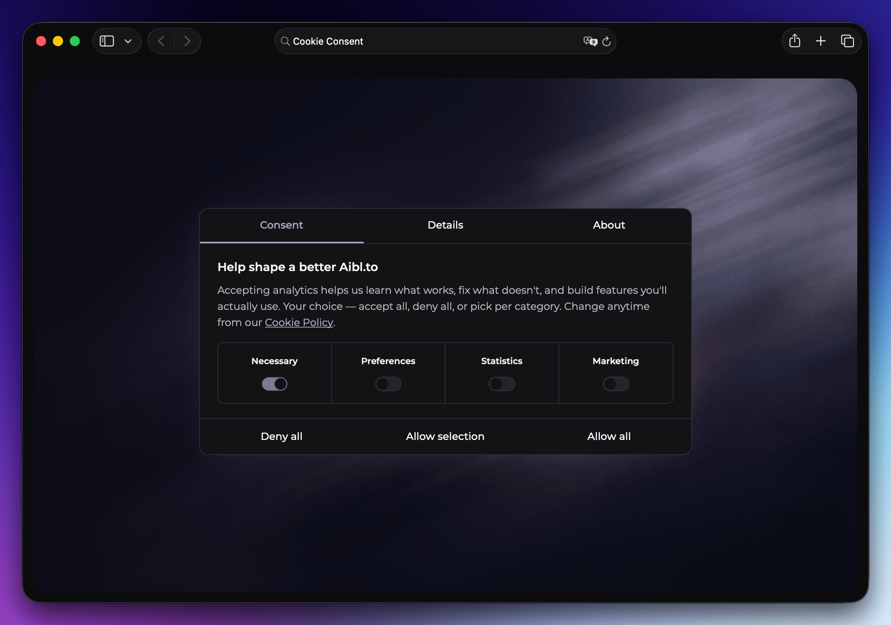

# @gceico/cookie-consent: self-hosted React cookie consent banner (Cookiebot alternative)

A self-contained, config-driven **cookie consent banner for React** apps, and a self-hosted
**Cookiebot alternative** you own instead of rent: no design-system dependency, no analytics
vendor lock-in, and a pluggable backend so you can log GDPR/CCPA consent decisions anywhere (or
nowhere).



- **Categorized consent**: necessary/preferences/statistics/marketing out of the box, fully
  configurable
- **Google Consent Mode v2** built in, GA4 wiring opt-in
- **GDPR/CCPA-style audit trail** via a pluggable `StorageAdapter` (Supabase, REST, or none)
- **No vendor lock-in**: no subscription, no third-party script tag, no external dashboard
- **Cookiebot migration**: one config flag parses and replaces a legacy Cookiebot cookie
- **Themeable with plain CSS variables**: no Tailwind or design-system dependency required

## Quick start

```bash
npm i @gceico/cookie-consent
# or
bun add @gceico/cookie-consent
```

```tsx
import { CookieConsent } from "@gceico/cookie-consent";
import "@gceico/cookie-consent/styles.css";

export function App() {
  return (
    <>
      {/* ...your app... */}
      <CookieConsent
        config={{
          text: {
            policyHref: "/cookie-policy/",
            privacyHref: "/privacy/",
          },
        }}
      />
    </>
  );
}
```

That's it — with no `config` at all you get a working, generically-worded banner with four
categories (necessary/preferences/statistics/marketing), a `cookie_consent` cookie, and no
backend logging (`noopAdapter`). Everything below is opt-in refinement.

## Config reference

All fields on `CookieConsentConfig` (passed as `config={...}`) are optional.

| Field                       | Type                         | Default                                    | Purpose                                                                           |
| --------------------------- | ---------------------------- | ------------------------------------------ | --------------------------------------------------------------------------------- |
| `cookieName`                | `string`                     | `"cookie_consent"`                         | Cookie the consent record is persisted under                                      |
| `tokenStorageKey`           | `string`                     | `"cc_token"`                               | localStorage key for the anonymous audit token                                    |
| `consentVersion`            | `number`                     | `1`                                        | Bump to invalidate existing cookies after a schema/copy change                    |
| `bannerVersion`             | `number`                     | `1`                                        | Recorded on every logged decision; track UI revisions independently               |
| `categories`                | `ConsentCategory[]`          | necessary/preferences/statistics/marketing | `{ id, label, description, alwaysOn }[]`                                          |
| `text`                      | `Partial<CookieConsentText>` | generic copy, see `src/config.ts`          | All banner strings; `{policyLink}`/`{privacyLink}` placeholders render as anchors |
| `trigger.timeoutMs`         | `number`                     | `6000`                                     | Show the banner after this many ms if the visitor hasn't scrolled                 |
| `trigger.scrollThresholdPx` | `number`                     | `400`                                      | Show the banner once the visitor scrolls this far                                 |
| `globalOpenFnName`          | `string`                     | `"openCookieConsent"`                      | `window[name]()` reopens the banner                                               |
| `openEventName`             | `string`                     | `"cookie-consent:open"`                    | Dispatch this event on `window` to reopen the banner                              |
| `storage`                   | `StorageAdapter`             | `noopAdapter()`                            | Where finished decisions get logged — see [Backend adapters](#backend-adapters)   |
| `consentMode`               | `ConsentModeOptions`         | `undefined` (off)                          | Google Consent Mode v2 + optional GA4 wiring — see below                          |
| `migrateFromCookiebot`      | `boolean`                    | `false`                                    | Parse + migrate a legacy Cookiebot cookie on first load                           |

Reopening the banner also works out of the box via `a[href="#consent"]` or any element with a
`data-open-consent` attribute — clicks on those are delegated automatically.

### `ConsentCategory`

```ts
interface ConsentCategory {
  id: string; // stable key, used in ConsentPrefs and the cookie
  label: string; // shown in the category grid + details tab
  description: string; // shown in the details tab
  alwaysOn: boolean; // true = can't be toggled off (e.g. "necessary")
}
```

### `CookieConsentText`

Every visible string in the banner — title, description, tab labels, category-grid labels come
from `categories` but descriptions/about copy/button labels are here. `description`,
`detailsFooter`, and each entry in `aboutParagraphs` may contain the literal placeholders
`{policyLink}` and `{privacyLink}`, which render as `<a href={text.policyHref}>` /
`<a href={text.privacyHref}>` respectively.

## Backend adapters

The component never talks to a database directly — it builds a `ConsentLogPayload` (token,
version, method, gpc, prefs, bannerVersion, userAgent, url) and hands it to whatever
`StorageAdapter` you configure via `config.storage`. Adapters are fire-and-forget: a failed log
never blocks the visitor's consent decision from applying.

### 1. Supabase (`supabaseAdapter`)

```ts
import { supabaseAdapter } from "@gceico/cookie-consent";

const storage = supabaseAdapter({
  url: import.meta.env.PUBLIC_SUPABASE_URL,
  anonKey: import.meta.env.PUBLIC_SUPABASE_PUBLISHABLE_KEY,
  table: "consent_logs", // optional, this is the default
});
```

Run the migration in `backend/supabase/migration.sql` against your project first (table name
must match the `table` option — both default to `consent_logs`):

```sql
create table if not exists public.consent_logs (
  id uuid primary key default gen_random_uuid(),
  created_at timestamptz not null default now(),
  token uuid not null,
  version int not null,
  method text not null check (method in ('explicit', 'gpc', 'migrated')),
  gpc boolean not null default false,
  prefs jsonb not null,
  banner_version int not null,
  user_agent text,
  url text
);
-- + indexes + RLS anon-insert-only policy, see the full file
```

### 2. Generic REST endpoint (`restAdapter`)

```ts
import { restAdapter } from "@gceico/cookie-consent";

const storage = restAdapter({
  endpoint: "/api/consent-log",
  headers: { "X-Api-Key": "..." }, // optional
});
```

Pair it with a serverless function like `backend/serverless/consent-endpoint.ts` (a
dependency-light, Netlify-Function-shaped reference handler you copy into your own
`netlify/functions/`, Vercel route, or equivalent):

```ts
export async function handler(event) {
  if (event.httpMethod !== "POST") return { statusCode: 405 };
  const payload = JSON.parse(event.body);
  // validate + insert/forward wherever you like
  return { statusCode: 204 };
}
```

### 3. No backend (`noopAdapter`)

The default. The banner still works fully — decisions are cookied and Consent Mode still
applies — they just aren't logged anywhere.

## Consent Mode v2 (opt-in)

Two pieces, both from `@gceico/cookie-consent`:

- `bootstrapConsentMode(options)` — call once, as early as possible (ideally inline in
  `<head>`, before any tag manager script), to set Consent Mode v2 defaults to denied and
  optionally load GA4.
- `applyConsent(prefs, options)` — called automatically by `<CookieConsent>` whenever the
  visitor's decision changes; you can also call it yourself if you need to re-apply consent
  elsewhere.

```html
<script type="module">
  import { bootstrapConsentMode } from "@gceico/cookie-consent";
  bootstrapConsentMode({
    measurementId: "G-XXXXXXX", // omit to skip GA4 entirely — Consent Mode still works
    region: ["EEA", "EU", "GB", "CH", "IS", "LI", "NO"],
  });
</script>
```

```tsx
<CookieConsent
  config={{
    consentMode: { measurementId: "G-XXXXXXX" },
  }}
/>
```

GA4 wiring is entirely opt-in — omit `measurementId` and you get pure Consent Mode v2 signal
management with no analytics script loaded. The `dataLayer`/`gtag` fallback and a configurable
custom event name (`eventName`, default `cookie_consent_update`) are always kept, so any tag
manager already reading `dataLayer` keeps working.

## Cookiebot migration (opt-in)

If you're replacing an existing Cookiebot install, set `migrateFromCookiebot: true`. On first
load, the banner will parse Cookiebot's legacy `CookieConsent` cookie into your category shape,
apply it as a `"migrated"` decision (skipping the visible banner for that visitor), and delete
Cookiebot's cookies so its script doesn't reappear if you haven't removed it from the page yet.

```tsx
<CookieConsent config={{ migrateFromCookiebot: true }} />
```

## Theming via CSS vars

Import `@gceico/cookie-consent/styles.css` once. Every color in the stylesheet is
`hsl(var(--ccb-*))` — no Tailwind required, no design-system dependency. Override any variable
on `:root` (or an ancestor of the banner) to re-theme it:

```css
:root {
  --ccb-primary: 220 90% 50%;
  --ccb-card: 0 0% 100%;
  --ccb-border: 220 15% 85%;
}
```

Dark mode is handled two ways simultaneously — `@media (prefers-color-scheme: dark)` and a
`.dark` class selector — so it works whether your app follows the OS theme or has its own
manual toggle.

## vs. Cookiebot, Osano, and other hosted consent-management platforms

Cookiebot, Osano, and similar hosted consent-management platforms (CMPs) mean a third-party
script, a subscription, and your visitors' consent decisions living in someone else's database.
`@gceico/cookie-consent` gives you the same UX pattern (categorized consent, Consent Mode v2, an
audit trail) as code you own: no recurring fee, no external script tag, and a backend you control
(or skip) instead of a vendor dashboard.

## Origin

Extracted from a production, config-driven cookie consent banner built for a small SaaS site,
generalized so it carries no brand-specific copy or styling.

## License

MIT

## Who's behind this

I'm Gabriel. I build things like this for fun and ship the ones that turn out
good. Check out [One's Skills](https://github.com/gceico/ones-skills), my
Claude Skills collection, [Claude Make It Rain](https://github.com/gceico/claude-make-it-rain), a
desktop app that rains money on your screen for Claude Code milestones, or come say hi at
[Aibl.to](https://aibl.to/), where I run AI workshops and help people turn their expertise into
compounded value.

— Gabriel C.
